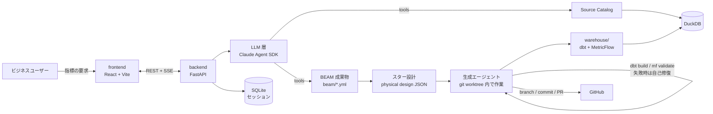

# ADP: BEAM✲ 対話型データモデリング基盤

| 項目 | 内容 |
|---|---|
| 著者 | daikono313 (Daisuke Harato) |
| 作成日 | 2026-10-10 |
| 正本 URL | https://github.com/daikono313/auto_data_platform/blob/main/docs/design-doc.md |
| ステータス | **In review**（承認は PR のマージをもって記録する） |
| Umbrella issue | [#18](https://github.com/daikono313/auto_data_platform/issues/18) |

## Objective

ビジネスユーザーが「xxx の売上指標を取りたい」と入力するだけで、Claude が BEAM✲ に沿ってヒアリングし、ディメンショナルモデル（dim / fct）・セマンティックレイヤー・テストを実装した PR が自動で作られる状態にする。

## Background

- 分析用データモデリングは、場当たり的な設計になりがち。その結果、保守が重くなり、分析できる範囲も狭くなる。
- BEAM✲（Business Event Analysis & Modeling、*Agile Data Warehouse Design*, Corr & Stagnitto）は、7W（Who / What / When / Where / How many / Why / How）の質問でビジネスイベントを掘り下げる手法。結果を BEAM Canvas と Event Matrix にまとめ、Kimball 流のディメンショナルモデルに落とし込む。
- この手順は質問のパターンがほぼ決まっているので、LLM で自動化しやすい。さらに Event Matrix → スター設計 → dbt 実装 → テストまで、構造化された中間成果物でつなぐことができる。
- これまで、ヒアリング・設計・実装・テストは別々の人と道具で行われ、要求とコードの対応が失われていた。本プロジェクトでは BEAM 成果物（YAML）を正本とし、要求からコードまでを辿れるようにする。

## Related documents

- [docs/certificate.md](certificate.md) — 完了条件（certificate）と自己マージ可否（promotion policy）
- [docs/modeling-conventions.md](modeling-conventions.md) — dbt モデリング規約（BEAM との対応、キー、テスト）
- [docs/knowledge/beam.md](knowledge/beam.md) — BEAM✲ の手法リファレンス（インタビューエージェントの知識源）
- [docs/adr/](adr/) — この設計書の確定後に生じた設計変更の記録
- [docs/guardrails.md](guardrails.md) — 生成コードとエージェントの安全な実行のための制限の一覧
- dbt Semantic Layer: https://docs.getdbt.com/docs/use-dbt-semantic-layer/dbt-sl?version=2 / latest spec: https://docs.getdbt.com/docs/build/latest-metrics-spec

## Goals

1. ビジネスユーザーが、専門用語を知らなくても、自分の欲しい指標を「定義されたメトリクス」として取得できるようになる。
2. 要求から PR までの所要時間を、人手の数日から 1 セッション（目安 30 分以内）に縮める。
3. 生成されるモデルが規約（命名・キー・テスト）にそろい、レビュアーは差分と BEAM 成果物だけを見て判断できる。
4. 要求（BEAM 成果物）・実装（dbt）・指標（Semantic Layer）が 1 つの PR の中で対応づけられ、後から辿れる。
5. （v2）ユーザーが、今どんなデータ・指標が見られるかを要求の前に知ることができる。
6. （v2）作った指標を、その場で切り口と期間を変えてチャートで見られる。チャートは Semantic Layer の指標を使い、集計を書き直さない。
7. （v2）ユーザーが質問のわかりにくさをその場で伝えられ、それが eval とプロンプトの改善につながる。

## Non-goals

- **複数ユーザーでの利用や認証。** MVP はローカルで 1 ユーザーが使う前提。
- **本番 DWH（Snowflake / BigQuery など）への接続。** MVP は DuckDB のみ。DWH を差し替えられる設計にはするが、検証はしない。
- **汎用 BI やダッシュボードの編集機能。** v2 で描画は入れるが、表示するのは Semantic Layer の指標を、決まった切り口・期間・チャートの種類で見る画面まで。ダッシュボードの自由なレイアウト編集、アドホックな SQL、権限管理は作らない（[ADR 0002](adr/0002-visualization-dbt-charts.md)）。
- **SCD Type2（属性の履歴管理）の実装。** 履歴が必要かどうかはヒアリングして記録するが、実装は Type1（上書き）のみ。
- **EC 以外の業務での品質保証。** 動作はするかもしれないが、eval は EC 売上のみ。
- **集計済みマート（`agg_*`）の生成。** 集計は Semantic Layer に一元化する。
- **Canvas / Matrix の UI 上での直接編集。** 修正はチャット経由で行う。
- **生成 PR の自動マージ。** 人がレビューしてマージする（/goal での本リポジトリ開発の自己マージとは別の話）。

## Scenarios

### S1: 店舗別の売上指標を作る（主シナリオ）

1. 営業企画の A さんが UI を開き、「店舗ごとの売上を見たい」と入力する。
2. Claude が要求を言い換えて確認する。「**日別・店舗別の売上金額（税抜）**、という理解で合っていますか？」
3. Claude が元になる出来事を特定する。「売上は『顧客が商品を注文する』時点で数えますか、『出荷』の時点ですか？」→ A さんは「注文」と答える。
4. Claude が 7W を順に聞く。誰が（顧客：会員ランク・地域）、何を（商品：カテゴリ）、いつ（注文日時）、どこで（店舗・チャネル）、なぜ（プロモーション）、どのように（支払方法）、いくつ（数量・金額）。それぞれ具体例も聞く。ソースに無い属性（例: 顧客の年収）を求められたら「データがありません」と伝え、記録して先へ進む。
5. 画面右側の BEAM Canvas と Event Matrix が、回答に合わせて埋まっていく。
6. Claude が粒度（「注文明細 1 行 = 1 レコード」）と優先度を確認し、要約を示す。A さんが「確定」を押す。
7. 進捗表示が「スター設計 → dbt 生成 → Semantic Layer 生成 → テスト（自己修復）→ PR」と進む。
8. PR が作られる。本文には要求、Canvas、Matrix、ER 図、テスト結果、未解決事項（年収データなし）が書かれている。データエンジニアがレビューしてマージする。
9. A さん（または BI）が `mf query --metrics revenue --group-by metric_time__day,store__store_name` で指標を取れる。

### S2: 既存ディメンションを再利用する

S1 の後、別のユーザーが「商品カテゴリ別の返品率」を求める。Claude は既にある `dim_product` と `dim_customer` を共通ディメンション（conformed dimension）として再利用すると提案する。新しく作るのは `fct_returns` と ratio メトリクスだけになる。

### S3（v2）: 使えるデータを見てから要求し、チャートで見る

1. A さんが開始画面を開くと、一番上に要求の入力欄があり、その下に「既存のデータ」（指標 — 例: 売上金額は店舗・チャネル・月で切れる。fact × dimension のバスマトリクス — 行が fact、列が dimension の属性で、集計できる組み合わせに ✓。検索で fact と結合できる dimension に絞り込める。Semantic Layer に未登録のモデルはその下に一覧）、さらにその下に「使える源泉（元データ）」（注文・顧客・商品…）が並ぶ（#62）。入力欄の下には、元データから作った「カテゴリ別の返品数量を見たい」のような要求の例も出る（クリックで入力欄に入る）。源泉ごとの「プロファイル」から、列の型・NULL 率・ユニーク数・よく出る値・キーの候補・使っているモデルを別ページで見られる。
2. 「店舗別の売上」はすでにあるのでチャートを開くと、店舗・月別の棒グラフが表示される。切り口をチャネルに、粒度を週に、期間を直近 3 か月に変えると描き直される。
3. 「返品率」は無いので、元データの一覧で返品のテーブルがあることを確認してから、「カテゴリ別の返品率を見たい」と要求する。インタビュー中も、画面の横で元データの一覧を参照できる。
4. インタビュー → 確定 → PR。PR にはチャートの定義も含まれる。完了画面から、作った指標の描画画面へ移動できる。

### S4（v2）: 質問にフィードバックする

1. インタビュー中、専門用語の多い質問に 👎 を押し、「『粒度』の意味がわからない」とコメントする。セッションの最後に全体の評価も付ける。フィードバックには、その時点のプロンプトのバージョンとモデルが記録される。
2. 開発者は `make feedback-report` で、段階ごとの低評価と該当する会話を確認する。
3. 低評価の会話から eval のチェックを作り、プロンプトを直して eval の前後比較で改善を確かめ、PR にする。

## Diagrams



### コンポーネント

| コンポーネント | 場所 | 役割 |
|---|---|---|
| frontend | `frontend/` | チャット UI、Canvas / Matrix 表示、生成の進捗表示 |
| backend | `backend/` | API、セッション管理、ジョブ実行、各ドメインロジック |
| `adp.beam` | `backend/src/adp/beam/` | BEAM 成果物の型（Pydantic）・検証・YAML 入出力（システムの中心） |
| `adp.interview` | `backend/src/adp/interview/` | BEAM インタビューの状態機械とプロンプト |
| `adp.catalog` | `backend/src/adp/catalog/` | DuckDB と dbt のメタデータをプロファイリングし、tool として公開 |
| `adp.ontology` | `backend/src/adp/ontology/` | オントロジー（業務の概念・属性・関係・制約）の型・検証・Mermaid の図の生成、源泉と dbt との照合（#67） |
| `adp.design` | `backend/src/adp/design/` | Event Matrix → スター設計への変換 |
| `adp.generation` | `backend/src/adp/generation/` | dbt / Semantic Layer / テストの生成と自己修復ループ |
| `adp.llm` | `backend/src/adp/llm/` | LLM 呼び出しの抽象化（モデルの段階的エスカレーション、認証の切り替え） |
| `adp.vcs` | `backend/src/adp/vcs/` | git worktree / commit / PR 作成 |
| warehouse | `warehouse/` | dbt プロジェクト（生成物の出力先）とサンプルデータの生成 |
| beam | `beam/` | 確定した BEAM 成果物（要求の正本） |
| ontology | `ontology/` | オントロジーの正本（`ontology.yml`）。`docs/ontology.md` はここから生成する |
| evals | `evals/` | インタビューと生成のシナリオ、期待成果物 |

## Glossary

- **ビジネスイベント**: 「顧客が商品を注文する」のような、測定対象となる業務上の出来事。fct テーブル 1 つに対応する。
- **7W**: Who / What / When / Where / How many / Why / How。How many が measure（数値）、残りがディメンションになる。
- **BEAM Canvas**: 1 イベントについて、中央に How many、周囲に 6W を配置した整理表。
- **Event Matrix**: 行がイベント、列がディメンションの表。ディメンションの共有状況と、優先度・インパクト・工数を表す。
- **粒度（grain）**: fct の 1 行が何を表すか。
- **conformed dimension（共通ディメンション）**: 複数の fct で共有されるディメンション。
- **BEAM 成果物**: Canvas と Matrix とメトリクス要求をまとめた構造化データ（`beam/*.yml`）。
- **certificate**: PR をマージしてよいと機械的に判定できる条件の集合（[certificate.md](certificate.md)）。
- **オントロジー**: 業務の概念（もの・人・場所 = entity、出来事 = event）と、その属性・関係・制約の整理（[ontology.md](ontology.md)、正本は `ontology/ontology.yml`）。entity は dim、event は fact の候補になる。源泉が増えたら、まずオントロジーを更新してから fact / dim を整理する。

## Constraints

- データ基盤はローカルの **DuckDB**。外部 DWH は使わない。
- dbt Semantic Layer のホスト版 API（JDBC / GraphQL、`dbt sl`）は dbt platform の有料プランが必要なので使わない。OSS の **`dbt-metricflow`（`mf`）** を使う。
- latest spec の YAML を使うため **dbt-core 1.12 以上**が必要。
- LLM は **Claude Agent SDK** 経由で呼ぶ。ローカルでは Claude Code のログイン認証を使うので従量課金はない。ただしサブスクリプションの利用上限がある。`ANTHROPIC_API_KEY` を設定すると API 認証に切り替わる（他人に提供する場合は API 認証が必須）。
- PR の作成には gh CLI の daikono313 トークンを使い、push は SSH で行う（`github-daikono313.com`）。
- 開発作業（人と /goal）はこのディレクトリ内で完結させる。ディレクトリ外の変更や削除はしない。

## Service level objectives

MVP の段階では手動で計測する。

| 指標 | 目標 |
|---|---|
| インタビュー応答の最初のトークンまで | p50 ≤ 5 秒 |
| 確定から PR 作成まで（1 イベント） | ≤ 15 分 |
| サンプルデータでの `dbt build`（全モデル） | ≤ 60 秒 |
| 生成物のテストが green で PR に到達する割合 | eval シナリオで ≥ 90% |
| 自己修復の再試行率 | 記録する（目標値は eval の結果を見て決める） |

## Monitoring / alerting

- 各ジョブの段階ごとに、所要時間・使用モデル・トークン数（取得できる場合）・再試行回数を SQLite に記録し、UI に表示する。
- アラートは MVP では設けない。eval の結果と再試行率を PR 本文に出す。

## Timeline

マイルストーンごとに、関係者に見せられる成果物を出す。

| M | 内容 | 見せられる成果物 | issue |
|---|---|---|---|
| M0 | 土台 | 設計書、CI が green の空リポジトリ | #1, #2 |
| M1 | データ基盤 | サンプルデータと共通ディメンション、Semantic Layer の PoC（`mf query`） | #3〜#6 |
| M2 | BEAM コア + ダミー UI | **ダミーデータで Canvas / Matrix が表示される UI**（要求の誤解を早めに見つけるため） | #7, #9 の一部 |
| M3 | インタビュー | 実際の対話で BEAM 成果物ができる（eval 合格） | #8, #9, #10 |
| M4 | 生成 | 確定した BEAM からテスト green の dbt と Semantic Layer ができる | #11〜#14 |
| M5 | PR / E2E | S1 が通しで動く | #15〜#17 |
| v2-0 | 修正・範囲 | 質問の重複表示の修正、v2 の設計 | #36, #37 |
| v2-1 | データ一覧 | 開始画面で使えるデータ・指標が見られる。源泉のデータプロファイル | #38, #39, #62 |
| v2-2 | 可視化 | dbt Charts で Semantic Layer の指標を描画できる画面、生成 PR にチャート定義 | #40〜#43 |
| v2-3 | フィードバック | 発言ごとの評価と、eval・プロンプト改善のサイクル | #44, #45 |
| v2-E2E | 通し | S3 と S4 の 1〜2（フィードバックが集計に出るまで）が通しで動く。S4 の 3（改善）は開発者の手順 | #46 |

## Interfaces

### UI（ラフ）

```
┌───────────── チャット ─────────────┬──────── BEAM Canvas ────────┐
│ Claude: 売上は「注文」時点で…？    │        Who: 顧客             │
│ あなた: 注文時点です               │ What: 商品   [How many]  When │
│ [選択肢A] [選択肢B]                │        Where / Why / How     │
│                                    ├──────── Event Matrix ───────┤
│ > 入力欄                           │ event × dim  優先度 工数     │
└────────────────────────────────────┴─ [確定して実装へ] ───────────┘
```

### API（backend）

| Method | Path | 内容 |
|---|---|---|
| POST | `/sessions` | セッションを開始する（最初の要求文を渡す） |
| POST | `/sessions/{id}/messages` | 回答を送る。応答は SSE で返す（テキストと BEAM 成果物の差分） |
| GET | `/sessions/{id}` | 会話と BEAM 成果物の現在状態を返す |
| POST | `/sessions/{id}/finalize` | BEAM 成果物を確定し、生成ジョブを開始する |
| GET | `/jobs/{id}/events` | 生成ジョブの進捗を SSE で返す |
| GET | `/datasets`（v2） | 取得可能な指標（と切り口）・モデル・元データ・BEAM 成果物の一覧（#38）と、fact × dimension のバスマトリクス（#62） |
| GET | `/ontology` | オントロジーの図（Mermaid）と、源泉・dbt のモデルとの食い違い、未整理の源泉（#67） |
| GET | `/sources/{table}/profile` | 源泉 1 つのデータプロファイル（列ごとの型・NULL 率・ユニーク数・最小/最大・上位の値、主キー/外部キーの候補、使っている整備済みモデル。#62）。読み取り専用の Catalog 経由で、対象スキーマ外は 404 |
| POST | `/sessions/{id}/feedback`（v2） | 発言ごとの評価（👍 / 👎・分類・コメント）、セッション全体の評価（5 段階・コメント）。同じ発言への送り直しは上書き（#44） |
| GET | `/feedback/categories`（v2） | フィードバックの分類（質問が重複している、専門用語がわからない など） |
| GET | `/charts/options?job_id=`（v2） | 描画できる指標と切り口。`job_id` を渡すと、その生成 PR の内容（マージ前の worktree）で見る（#43） |
| POST | `/charts/render?job_id=`（v2） | 指標・切り口・粒度・期間から SVG を描く（#43、ADR 0003） |

### ファイル形式

- `beam/<event_name>.yml`: BEAM 成果物。JSON Schema は `adp.beam` から生成し、frontend の TS 型もここから生成する。
- `warehouse/models/**`: dbt の SQL と YAML（Semantic Layer は latest spec で model YAML 内に書く）。
- `warehouse/charts/*.yml`（v2）: dbt Charts のチャート定義。指標名と切り口で書き、集計の SQL を手で書かない（O4 の仕組みで生成する）。

## Dependencies / infrastructure

変更しにくい依存（言語・ストレージ）を中心に記す。

| 領域 | 採用 |
|---|---|
| 言語 | Python 3.12（backend、dbt）、TypeScript（frontend） |
| パッケージ管理 | uv / pnpm |
| Web | FastAPI + SSE / Vite + React + Tailwind + shadcn/ui |
| アプリの永続化 | SQLite（SQLModel）、`.adp/app.db` |
| DWH | DuckDB（`warehouse/data/*.duckdb`、git では追跡しない） |
| 変換とメトリクス | dbt-core 1.12+ / dbt-duckdb / dbt-metricflow / dbt_utils |
| LLM | Claude Agent SDK（Sonnet 5.5 を既定、失敗時に Opus 5.5 へ上げる） |
| GitHub | gh CLI（daikono313）+ SSH |
| 可視化（v2） | dbt Charts 0.9.x（Apache-2.0。依存が増える: pyarrow、vl-convert-python、pillow など） |
| CI | GitHub Actions（LLM はモック） |

アプリの実行時データ（DB、worktree、ログ）は `.adp/` に置き、git では追跡しない。

## Security

- **信頼の境界**: ソースデータ、カラムコメント、ユーザー入力は**データとして扱い、指示としては扱わない**。LLM に渡すときはタグで区切り、tool の結果は検証してから BEAM 成果物に反映する。
- **生成エージェントの権限**: 作業はリポジトリ内の git worktree（`.adp/worktrees/<branch>`）に限る。許可するコマンドは `dbt`、`mf`、`git`（push は生成ブランチのみ）、`gh pr create` に絞る。ファイル操作は worktree の外を禁止する。
- **シークレット**: `.env` に置き、git では追跡しない。生成物、PR 本文、ログに API キーやトークンを出さない。
- **公開範囲**: リポジトリは public。サンプルデータは合成データのみとし、実データは入れない。

### v2 で増える信頼の境界

- **dbt Charts のサーバー（`dct serve`）**: 認証の無いサーバーで、任意の SQL を実行できる機能がある。使わない。描画画面は backend のプロセス内で SVG を描き、`` で表示する（ADR 0003）。画面から受け取るのは指標名・切り口名・粒度・期間だけで、Semantic Layer の一覧と照らし合わせる。
- **チャート定義の SQL**: dbt Charts の定義には SQL を書ける。生成するチャート定義には手書きの SQL を入れず、Semantic Layer の指標から作ったものだけにし、CI で確認する（O4）。
- **生成エージェントのガード**: チャートの生成と描画（`dct render`）は、エージェントではなくパイプラインが決まった手順で行う（#42）。エージェントには `dct` を許可せず、`charts/` と `chart_specs/` にも書かせない。描画は dbt プロファイル経由なので、DuckDB の外部アクセス禁止が効く（#40）。
- **フィードバックの文章**: ユーザーの自由記述は、Claude に要約させるときもデータとして扱い、指示として扱わない。

## Privacy

- MVP は合成データのみなので個人情報は扱わない。
- 会話ログは `.adp/app.db` にローカル保存する。保持期限は設けないが、git では追跡しない。
- （v2）フィードバック（コメント、その時点のプロンプトのバージョン、会話の抜粋）は `.adp/app.db` にだけ保存する。フィードバックから eval のケースを作るときは、会話をそのままコミットせず、合成した内容に書き換えてから公開リポジトリに入れる（実データの会話を入れない）。保持期限は 180 日（R21）。

## Legal considerations

- 新しい依存はライセンス（MIT / Apache-2.0 / BSD 系）を確認する。（v2）dbt Charts と、その依存で増えるもの（pyarrow、vl-convert-python、pillow など）も #40 で確認する。
- 他人にアプリを提供する場合、LLM の認証は API キーにする（Claude Code のログイン認証を第三者向けに使わない）。
- リポジトリのライセンスは未定（Open issue O3）。

## Logging

- backend は構造化ログ（JSON）を `.adp/logs/` に出す。（MVP では LLM の使用量 `llm.jsonl` のみ。生成の各段階はジョブの記録で代替する。[guardrails.md](guardrails.md) の 6）
- 重要なイベント: セッション開始・確定、ツール呼び出し、生成の各段階、自己修復の試行、PR 作成。
- ログに出さないもの: API キー、トークン、`.env` の内容。

## Open issues

| # | 問題 | 選択肢 | 次の一手 |
|---|---|---|---|
| O2 | Agent SDK（CLI 起動）の応答速度が SLO を満たすか | (a) 満たす (b) インタビューだけ Messages API にする | #8 で計測する |
| O3 | リポジトリのライセンス | MIT / Apache-2.0 / 指定なし | オーナーが判断する |
| O8 | 描画の応答時間の目標と、MetricFlow の結果のキャッシュ | — | #41 / #43 で計測して SLO に追加する |

## Resolved issues

| # | 決定 | 理由 |
|---|---|---|
| R1 | 想定ユーザーはビジネスユーザー | 専門用語なしで質問し、変換は裏で行う。データエンジニアは PR でレビューする |
| R2 | サンプルデータは EC の合成データを自作する | 7W がすべてそろうデータが既製品には無い |
| R3 | UI は日本語。識別子は英語の snake_case。dbt の description は日本語 | 利用者とコード規約の両方に合わせる |
| R4 | モデルは Sonnet 5.5 を既定とし、失敗時に Opus 5.5 へ上げる | コスト効率。再試行率は記録する |
| R5 | 集計は Semantic Layer に一元化し、マートは dim / fct まで | 指標定義の二重管理を避ける |
| R6 | SCD は Type1 のみ実装する（履歴の要否は記録する） | MVP の範囲を絞る |
| R7 | ソースに無い要求は記録して先へ進み、PR に書き、issue も起票する | インタビューを止めない |
| R8 | Canvas / Matrix は表示のみ。修正はチャット経由 | 同期処理の複雑さを避ける |
| R9 | /goal の開発は issue ごとに PR を作り、CI green とレビュー合格で自己マージする | [certificate.md](certificate.md) を参照 |
| R10 | LLM は Agent SDK 経由。認証はローカルでは Claude Code、設定があれば API キー | 開発中の従量課金を避けつつ、提供時にも対応できる |
| R11 | 自己修復は Sonnet で 2 回、その後 Opus で 1 回。それでも直らなければ人に渡す | — |
| R12 | Semantic Layer は dbt Semantic Layer（OSS MetricFlow、latest spec） | dbt と一体で管理でき、標準仕様に沿う |
| R13 | Web は FastAPI + React | backend を dbt・MetricFlow・Agent SDK と同じ Python にそろえられる |
| R14 | PR 作成は gh CLI（daikono313） | ローカル MVP では追加の設定が不要 |
| R15 | 細かい選定（Vite / shadcn / SSE / SQLite / uv / pnpm / dbt_utils / ハッシュのサロゲートキー / `beam/*.yml` / ブランチ名 `beam/<event>-<yyyymmdd>` / 既存 dim は再利用し、カラム追加のみ許可） | 後から戻せる項目のため推奨案で確定 |
| R16 | MetricFlow は DuckDB + latest spec で動く（cumulative の window はフラグで対応）。backend からは `mf` CLI で呼ぶ | [ADR 0001](adr/0001-metricflow-on-duckdb.md) |
| R17 | 可視化は dbt Charts（0.9.x）を使う。接続は dbt のプロファイル経由（`warehouse/dbt_charts.yml`）で、DuckDB の SQL には外部アクセス禁止がそのまま効く。DuckDB の外の経路（独自の duckdb ソース、ボードの HTTP 取得）は、設定ファイルの保護とボードの検査で塞ぐ（O6・O9 を解決） | [ADR 0002](adr/0002-visualization-dbt-charts.md) |
| R18 | チャートは指標と切り口だけで書き（`warehouse/chart_specs/*.yml`）、MetricFlow が作る SQL（`mf query --explain`、カタログ名は外す）を埋め込んだ dbt Charts のボードを `python -m adp.charts compile` で書き出す。手書きの SQL のボードと古いボードは `make dbt-build` で検出する（O4 を (a) で解決） | [ADR 0002](adr/0002-visualization-dbt-charts.md) |
| R19 | 生成 PR には既定のチャート（指標ごとに 1 つ）を含め、本文に PNG を載せる。画像は PR のブランチで追加した直後の commit で消し、本文は画像のある commit の URL で参照する（main にバイナリを残さない。squash merge が前提） | #42、[modeling-conventions](modeling-conventions.md) |
| R20 | 描画画面は MetricFlow（semantic manifest だけを読み、DB に接続しない）と dbt Charts を backend のプロセス内で使い、SVG を `` で表示する。生成ジョブの worktree でマージ前の PR の内容も見られる（O5 を解決） | [ADR 0003](adr/0003-chart-view-in-process.md) |
| R21 | フィードバックは `.adp/app.db` に、その発言を作ったときの段階・質問・選択肢・プロンプトのバージョン（`interview-v<N>+<内容のハッシュ>`）・モデルと一緒に保存する。保持期限は 180 日で、backend の起動時に古いものを削除する（`ADP_FEEDBACK_RETENTION_DAYS` で変更、0 で無期限）。個別に消すときは app.db から削除する。期限で消えるのはフィードバックだけで、会話そのもの（sessions テーブル）は残る（O7 を解決） | #44 |

## Alternatives considered

- **Next.js（フルスタック TS）**: frontend と backend を 1 つの言語にできるが、dbt・MetricFlow・Agent SDK（Python）との連携が別プロセスになる。不採用。
- **Cube をセマンティックレイヤーにする**: 単体で API を持つが、dbt との二重管理になる。不採用。
- **dbt platform の Semantic Layer API**: 有料プランが必要で、DuckDB に対応しない。不採用。
- **インタビューを Messages API + tool use で実装する**: 応答は速いが、API キーと従量課金が必要になる。速度に問題が出たときの代替として残す（O2）。
- **TPC-H / jaffle_shop をサンプルにする**: すぐ使えるが、Why / How の 7W が欠ける。不採用。
