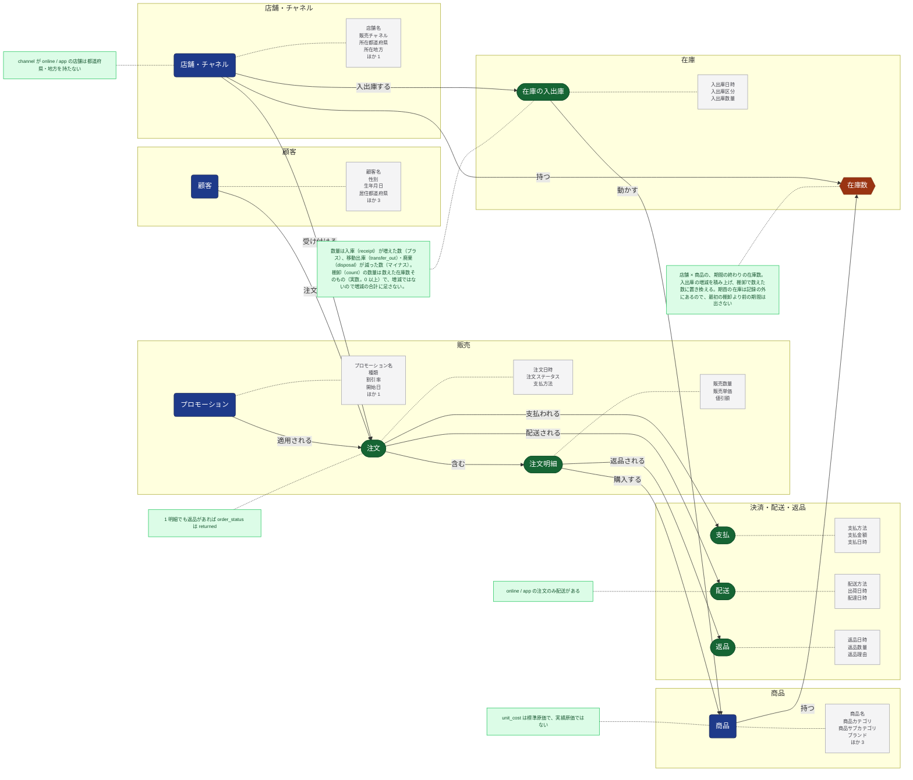

<!-- このファイルは ontology/ontology.yml から生成する（make ontology）。手で編集しない。 -->

# オントロジー

業務の概念と、その属性・関係・制約。源泉が増えたら、まず `ontology/ontology.yml` を更新し、それを元に fact / dim を整理する。

凡例: 四角 = もの・人・場所（entity → dim の候補）、長円 = 出来事（event → fact の候補）、六角形 = 状態（state → 定期スナップショットの fact の候補）、灰色 = 属性（一部）、緑 = 制約、矢印 = 関係

## 概念

| 概念 | 種類 | ドメイン | 源泉（キー） | モデル | 属性 |
|---|---|---|---|---|---|
| 顧客 `customer` | もの・人 | 顧客 | `raw.customers`（`customer_id`） | `dim_customer` | 顧客名（`customer_name`。説明）、性別（`gender`。説明）、生年月日（`birth_date`。時刻）、居住都道府県（`prefecture`。説明。上の階層は居住地方）、居住地方（`region`。説明）、会員ランク（`membership_rank`。説明）、会員登録日（`signup_date`。時刻） |
| 商品 `product` | もの・人 | 商品 | `raw.products`（`product_id`） | `dim_product` | 商品名（`product_name`。説明。上の階層は商品サブカテゴリ）、商品カテゴリ（`category`。説明）、商品サブカテゴリ（`subcategory`。説明。上の階層は商品カテゴリ）、ブランド（`brand`。説明）、定価（`list_price`。数値）、標準原価（`unit_cost`。数値）、発売日（`launched_on`。時刻） |
| 店舗・チャネル `store` | もの・人 | 店舗・チャネル | `raw.stores`（`store_id`） | `dim_store` | 店舗名（`store_name`。説明）、販売チャネル（`channel`。説明）、所在都道府県（`prefecture`。説明。上の階層は所在地方）、所在地方（`region`。説明）、開店日（`opened_on`。時刻） |
| プロモーション `promotion` | もの・人 | 販売 | `raw.promotions`（`promotion_id`） | `dim_promotion` | プロモーション名（`promotion_name`。説明）、種類（`promotion_type`。説明）、割引率（`discount_rate`。数値）、開始日（`start_date`。時刻）、終了日（`end_date`。時刻） |
| 注文 `order` | 出来事 | 販売 | `raw.orders`（`order_id`） | 未整備 | 注文日時（`ordered_at`。時刻）、注文ステータス（`order_status`。説明）、支払方法（`payment_method`。正本は支払の支払方法） |
| 注文明細 `order_line` | 出来事 | 販売 | `raw.order_items`（`order_item_id`） | `fct_order_lines` | 販売数量（`quantity`。数値）、販売単価（`unit_price`。数値）、値引額（`discount_amount`。数値） |
| 支払 `payment` | 出来事 | 決済・配送・返品 | `raw.payments`（`payment_id`） | 未整備 | 支払方法（`payment_method`。説明）、支払金額（`amount`。数値）、支払日時（`paid_at`。時刻） |
| 配送 `shipment` | 出来事 | 決済・配送・返品 | `raw.shipments`（`shipment_id`） | 未整備 | 配送方法（`shipping_method`。説明）、出荷日時（`shipped_at`。時刻）、配達日時（`delivered_at`。時刻） |
| 返品 `return` | 出来事 | 決済・配送・返品 | `raw.returns`（`return_id`） | 未整備 | 返品日時（`returned_at`。時刻）、返品数量（`quantity`。数値）、返品理由（`return_reason`。説明） |
| 在庫の入出庫 `inventory_movement` | 出来事 | 在庫 | `raw.inventory`（`inventory_id`） | `fct_stock_movements` | 入出庫日時（`moved_at`。時刻）、入出庫区分（`movement_type`。説明）、入出庫数量（`quantity`。数値） |
| 在庫数 `stock_level` | 状態 | 在庫 | `raw.inventory`（`inventory_id`） | 未整備 | - |

## 関係

件数の対応は、列（via）を持つ側から見た、相手との件数の関係。

| から | 関係 | へ | 列 | 件数の対応 |
|---|---|---|---|---|
| 顧客 | 注文する | 注文 | `raw.orders.customer_id` | 顧客 1 件に注文が複数、注文には必ず顧客がある |
| 店舗・チャネル | 受け付ける | 注文 | `raw.orders.store_id` | 店舗・チャネル 1 件に注文が複数、注文には必ず店舗・チャネルがある |
| プロモーション | 適用される | 注文 | `raw.orders.promotion_id` | プロモーション 1 件に注文が複数、プロモーションが決まっていない注文がある |
| 注文 | 含む | 注文明細 | `raw.order_items.order_id` | 注文 1 件に注文明細が複数、注文明細には必ず注文がある |
| 注文明細 | 購入する | 商品 | `raw.order_items.product_id` | 商品 1 件に注文明細が複数、注文明細には必ず商品がある |
| 注文 | 支払われる | 支払 | `raw.payments.order_id` | 注文 1 件に支払は 1 件まで、支払には必ず注文がある |
| 注文 | 配送される | 配送 | `raw.shipments.order_id` | 注文 1 件に配送は 1 件まで、配送には必ず注文がある |
| 注文明細 | 返品される | 返品 | `raw.returns.order_item_id` | 注文明細 1 件に返品は 1 件まで、返品には必ず注文明細がある |
| 店舗・チャネル | 入出庫する | 在庫の入出庫 | `raw.inventory.store_id` | 店舗・チャネル 1 件に在庫の入出庫が複数、在庫の入出庫には必ず店舗・チャネルがある |
| 在庫の入出庫 | 動かす | 商品 | `raw.inventory.product_id` | 商品 1 件に在庫の入出庫が複数、在庫の入出庫には必ず商品がある |
| 店舗・チャネル | 持つ | 在庫数 | `raw.inventory.store_id` | - |
| 商品 | 持つ | 在庫数 | `raw.inventory.product_id` | - |

## 制約

| 概念 | 制約 |
|---|---|
| 店舗・チャネル | channel が online / app の店舗は都道府県・地方を持たない |
| 注文 | 1 明細でも返品があれば order_status は returned |
| 配送 | online / app の注文のみ配送がある |
| 商品 | unit_cost は標準原価で、実績原価ではない |
| 在庫の入出庫 | 数量は入庫（receipt）が増えた数（プラス）、移動出庫（transfer_out）・廃棄（disposal）が減った数（マイナス）。棚卸（count）の数量は数えた在庫数そのもの（実数。0 以上）で、増減ではないので増減の合計に足さない。 |
| 在庫数 | 店舗 × 商品の、期間の終わりの在庫数。入出庫の増減を積み上げ、棚卸で数えた数に置き換える。期首の在庫は記録の外にあるので、最初の棚卸より前の期間は出さない |
