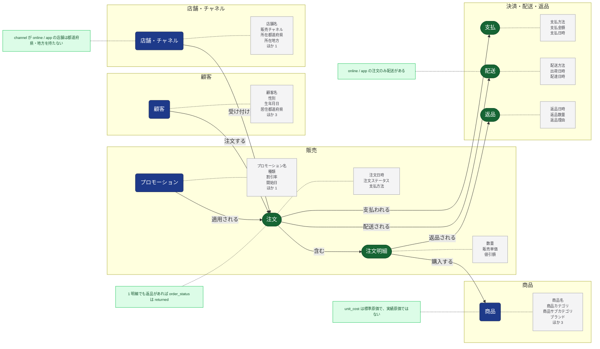

<!-- このファイルは ontology/ontology.yml から生成する（make ontology）。手で編集しない。 -->

# オントロジー

業務の概念と、その属性・関係・制約。源泉が増えたら、まず `ontology/ontology.yml` を更新し、それを元に fact / dim を整理する。

凡例: 四角 = もの・人・場所（entity → dim の候補）、長円 = 出来事（event → fact の候補）、灰色 = 属性（一部）、緑 = 制約、矢印 = 関係

## 概念

| 概念 | 種類 | ドメイン | 源泉（キー） | モデル | 属性 |
|---|---|---|---|---|---|
| 顧客 `customer` | もの・人 | 顧客 | `raw.customers`（`customer_id`） | `dim_customer` | 顧客名（`customer_name`）、性別（`gender`）、生年月日（`birth_date`）、居住都道府県（`prefecture`）、居住地方（`region`）、会員ランク（`membership_rank`）、会員登録日（`signup_date`） |
| 商品 `product` | もの・人 | 商品 | `raw.products`（`product_id`） | `dim_product` | 商品名（`product_name`）、商品カテゴリ（`category`）、商品サブカテゴリ（`subcategory`）、ブランド（`brand`）、定価（`list_price`）、標準原価（`unit_cost`）、発売日（`launched_on`） |
| 店舗・チャネル `store` | もの・人 | 店舗・チャネル | `raw.stores`（`store_id`） | `dim_store` | 店舗名（`store_name`）、販売チャネル（`channel`）、所在都道府県（`prefecture`）、所在地方（`region`）、開店日（`opened_on`） |
| プロモーション `promotion` | もの・人 | 販売 | `raw.promotions`（`promotion_id`） | `dim_promotion` | プロモーション名（`promotion_name`）、種類（`promotion_type`）、割引率（`discount_rate`）、開始日（`start_date`）、終了日（`end_date`） |
| 注文 `order` | 出来事 | 販売 | `raw.orders`（`order_id`） | 未整備 | 注文日時（`ordered_at`）、注文ステータス（`order_status`）、支払方法（`payment_method`） |
| 注文明細 `order_line` | 出来事 | 販売 | `raw.order_items`（`order_item_id`） | `fct_order_lines` | 数量（`quantity`）、販売単価（`unit_price`）、値引額（`discount_amount`） |
| 支払 `payment` | 出来事 | 決済・配送・返品 | `raw.payments`（`payment_id`） | 未整備 | 支払方法（`payment_method`）、支払金額（`amount`）、支払日時（`paid_at`） |
| 配送 `shipment` | 出来事 | 決済・配送・返品 | `raw.shipments`（`shipment_id`） | 未整備 | 配送方法（`shipping_method`）、出荷日時（`shipped_at`）、配達日時（`delivered_at`） |
| 返品 `return` | 出来事 | 決済・配送・返品 | `raw.returns`（`return_id`） | `fct_returns` | 返品日時（`returned_at`）、返品数量（`quantity`）、返品理由（`return_reason`） |

## 関係

| から | 関係 | へ | 列 |
|---|---|---|---|
| 顧客 | 注文する | 注文 | `raw.orders.customer_id` |
| 店舗・チャネル | 受け付ける | 注文 | `raw.orders.store_id` |
| プロモーション | 適用される | 注文 | `raw.orders.promotion_id` |
| 注文 | 含む | 注文明細 | `raw.order_items.order_id` |
| 注文明細 | 購入する | 商品 | `raw.order_items.product_id` |
| 注文 | 支払われる | 支払 | `raw.payments.order_id` |
| 注文 | 配送される | 配送 | `raw.shipments.order_id` |
| 注文明細 | 返品される | 返品 | `raw.returns.order_item_id` |

## 制約

| 概念 | 制約 |
|---|---|
| 店舗・チャネル | channel が online / app の店舗は都道府県・地方を持たない |
| 注文 | 1 明細でも返品があれば order_status は returned |
| 配送 | online / app の注文のみ配送がある |
| 商品 | unit_cost は標準原価で、実績原価ではない |
